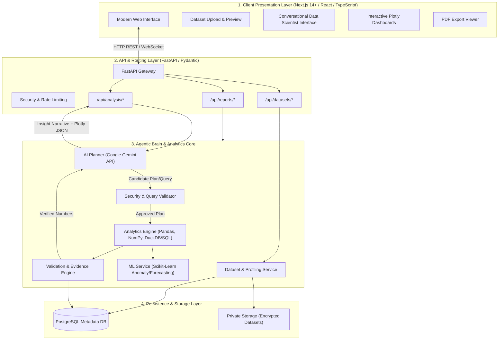
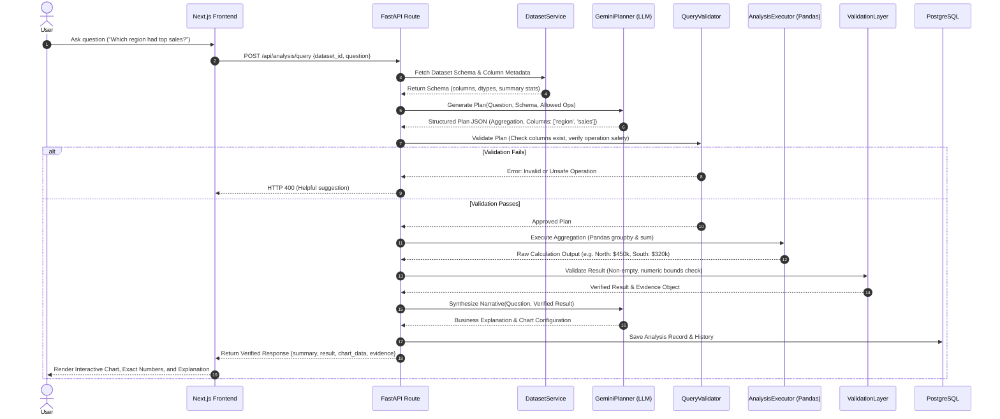

# InsightGen AI — Master Architecture, Workflow & System Design Blueprint

---

## 1. Executive Summary & Problem Statement

### 1.1 The Problem
In modern business environments, raw datasets (CSV, Excel, SQL databases) contain critical business intelligence. However, deriving actionable insights from them typically requires:
- Data Analysts and Engineers writing complex SQL queries and Python (Pandas/NumPy) scripts.
- Business stakeholders waiting days or weeks for ad-hoc reports and charts.
- Off-the-shelf generative AI chatbots (like standard ChatGPT/Gemini) suffering from **hallucinations** when calculating mathematical numbers, aggregations, or statistical metrics because LLMs are generative text prediction engines, not calculation engines.

### 1.2 The InsightGen AI Solution
**InsightGen AI** is an **Agentic AI Data Scientist** platform. It bridges the gap between natural language interaction and deterministic calculation:
1. **The User Asks** in plain English or Hinglish: *"Which region had the highest profit margin last quarter?"* or *"Detect unusual transaction spikes in May."*
2. **AI Plans**: Google Gemini (via official `google-genai` SDK) decomposes the query and generates a structured, verified analysis plan or SQL/Pandas code specification.
3. **Deterministic Engine Calculates**: Python (Pandas/NumPy/SciPy/scikit-learn) or a secured SQL database executes the real calculation. **The LLM never guesses mathematical figures.**
4. **Validation & Evidence Layer**: Verifies that the calculations are sound, matches constraints, and computes evidence metadata.
5. **Synthesis & Visualization**: Gemini synthesizes the verified outputs into business recommendations, accompanied by interactive **Plotly** visualizations and downloadable PDF reports.

---

## 2. Requirements Specification

### 2.1 Functional Requirements (FR)
- **FR-01: Dataset Ingestion & Validation**: Multi-format upload (CSV, XLSX, XLS), MIME type verification, file size guardrails, encoding detection (UTF-8, Latin-1), and sanitization.
- **FR-02: Automated Dataset Profiling**: Instant computation of row/column count, schema detection, missing values, duplicates, summary statistics (mean, median, standard deviation, quantiles), and top-row preview.
- **FR-03: Natural Language Querying**: Parsing arbitrary business questions into semantic intents (Aggregation, Trend, Comparison, Anomaly Detection, Forecast).
- **FR-04: Structured AI Planning**: Prompt-engineered Gemini agent producing strictly structured JSON plans (Pydantic validated).
- **FR-05: Sandboxed Deterministic Execution**: Secure execution of Pandas / SQL transformations without arbitrary remote code execution (RCE) hazards.
- **FR-06: Interactive Visualizations**: Dynamic generation of Plotly charts (Bar, Line, Scatter, Box plot, Heatmap) tailored to data distribution.
- **FR-07: Business Reports**: Exporting structured insights, charts, and executive summaries to downloadable PDF documents.

### 2.2 Non-Functional Requirements (NFR)
- **NFR-01: Correctness & Zero Hallucination**: Mathematical figures must originate strictly from deterministic computation engines, never generated directly by LLM tokens.
- **NFR-02: Performance & Latency**: Dataset profiling < 2 seconds for files up to 100k rows. Natural language query resolution < 5 seconds.
- **NFR-03: Security & Sandboxing**:
  - API keys strictly server-side (never exposed to client bundle).
  - No unrestricted arbitrary code execution.
  - Safe file storage isolating tenant files via UUIDs.
  - Query validation stopping dangerous operations (`DROP`, `DELETE`, `ALTER`, OS command injection).
- **NFR-04: Reliability & Graceful Degradation**: Clear, user-friendly error messages if data is malformed, columns do not exist, or queries are ambiguous.
- **NFR-05: Maintainability**: Strict separation of concerns (Presentation / API Route / Service / Analytics / AI Planner / Validation / Database).

---

## 3. High-Level Design (HLD)

### 3.1 Architecture Diagram



### 3.2 Component Responsibilities

| Component | Technology | Primary Responsibility |
| :--- | :--- | :--- |
| **Frontend** | Next.js, React, TypeScript, Tailwind | Responsive UI, state management, file upload preview, chat stream, Plotly chart rendering. |
| **API Gateway** | FastAPI, Uvicorn, Pydantic | Endpoint routing, request/response validation, CORS, error normalization. |
| **AI Planner** | Gemini 2.5/Pro (google-genai SDK) | Intent classification, schema reasoning, structured plan synthesis (JSON schema enforced). |
| **Query Validator** | Python AST & SQLGlot / Rule Engine | Sanitizes operations, blocks unsafe commands, ensures column references match dataset schema. |
| **Analytics Engine** | Pandas, NumPy, DuckDB / SQL | Deterministic data manipulation, filtering, aggregation, statistical summary calculations. |
| **ML Engine** | Scikit-Learn, Statsmodels | Unsupervised anomaly detection (IsolationForest), time-series forecasting (ARIMA / Prophet). |
| **Validation Layer** | Pydantic, Custom Logic | Checks result bounds, verifies execution evidence, ensures results answer the user's question. |
| **Database** | PostgreSQL | Persists user accounts, dataset metadata, chat sessions, analysis history, report metadata. |

---

## 4. Low-Level Design (LLD)

### 4.1 Modular Directory Structure

```text
InsightGen-AI/
├── .env.example                     # Sample configuration
├── .env                             # Local secrets (git-ignored)
├── .gitignore                       # Standard ignore rules
├── AGENTS.md                        # Project instructions & guidelines
├── README.md                        # Project overview & quickstart
├── docs/
│   └── PROJECT_BLUEPRINT.md         # This master architecture guide
├── sample_data/                     # Verified test datasets
│   └── sample_sales.csv
├── backend/
│   ├── requirements.txt             # Python dependencies
│   ├── .env                         # Backend-specific environment
│   ├── app/
│   │   ├── __init__.py
│   │   ├── main.py                  # FastAPI application entrypoint
│   │   ├── core/
│   │   │   ├── __init__.py
│   │   │   ├── config.py            # Pydantic Settings
│   │   │   └── security.py          # CORS, sanitization
│   │   ├── api/
│   │   │   ├── __init__.py
│   │   │   └── routes/
│   │   │       ├── __init__.py
│   │   │       ├── health.py        # /health endpoint
│   │   │       ├── datasets.py      # /api/datasets endpoints
│   │   │       └── analysis.py      # /api/analysis endpoints
│   │   ├── schemas/
│   │   │   ├── __init__.py
│   │   │   ├── health.py            # Health check schemas
│   │   │   ├── dataset.py           # Upload & profile schemas
│   │   │   └── analysis.py          # Query & response schemas
│   │   ├── services/
│   │   │   ├── __init__.py
│   │   │   ├── dataset_service.py   # File validation, ingestion, preview
│   │   │   ├── profiling_service.py # Column types, stats, null counts
│   │   │   ├── planner_service.py   # Gemini prompt & structured plan
│   │   │   ├── validator_service.py # Security checks & AST validation
│   │   │   ├── executor_service.py  # Sandboxed execution engine
│   │   │   └── report_service.py    # PDF generation
│   │   └── database/
│   │       ├── __init__.py
│   │       ├── session.py           # SQLAlchemy / asyncpg session
│   │       └── models.py            # PostgreSQL ORM entities
│   └── tests/
│       ├── test_health.py
│       └── test_datasets.py
└── frontend/                        # Next.js Application
    ├── package.json
    ├── tsconfig.json
    ├── tailwind.config.ts
    └── src/
        ├── app/
        │   ├── layout.tsx
        │   └── page.tsx             # Dashboard & workflow container
        ├── components/
        │   ├── ui/                  # Reusable UI primitives
        │   ├── datasets/            # Upload and preview table
        │   ├── analytics/           # Query box and result charts
        │   └── common/              # Navigation, status indicators
        └── lib/
            ├── api.ts               # Axios / Fetch client
            └── types.ts             # TypeScript definitions
```

### 4.2 Sequence Diagram: Natural Language Query to Verified Insight



---

## 5. API Specification

### 5.1 Health Check
- **`GET /health`**
  - **Description**: Verifies API availability, environment configuration, and version status.
  - **Response 200**:
    ```json
    {
      "status": "healthy",
      "timestamp": "2026-10-27T06:08:00Z",
      "environment": "development",
      "version": "1.0.0"
    }
    ```

### 5.2 Datasets
- **`POST /api/datasets/upload`**
  - **Description**: Uploads a CSV or Excel file, validates headers, computes shape, and returns a unique `dataset_id`.
  - **Form Data**: `file: File`
  - **Response 200**:
    ```json
    {
      "dataset_id": "ds_9f8e7d6c",
      "filename": "q3_sales.csv",
      "row_count": 12500,
      "column_count": 8,
      "file_size_bytes": 1048576,
      "created_at": "2026-10-27T06:10:00Z"
    }
    ```

- **`GET /api/datasets/{dataset_id}/profile`**
  - **Description**: Returns detailed profiling data including missing values, data types, statistical distributions, and a row preview.
  - **Response 200**:
    ```json
    {
      "dataset_id": "ds_9f8e7d6c",
      "filename": "q3_sales.csv",
      "total_rows": 12500,
      "total_columns": 8,
      "columns": [
        {"name": "region", "dtype": "string", "null_count": 0, "unique_count": 4},
        {"name": "sales", "dtype": "float64", "null_count": 12, "mean": 452.3, "min": 10.0, "max": 9800.0}
      ],
      "preview": [
        {"region": "North", "sales": 450.0},
        {"region": "South", "sales": 120.5}
      ]
    }
    ```

### 5.3 Analysis & Natural Language Query
- **`POST /api/analysis/query`**
  - **Payload**:
    ```json
    {
      "dataset_id": "ds_9f8e7d6c",
      "question": "Which region generated the highest revenue?",
      "chart_preference": "auto"
    }
    ```
  - **Response 200**:
    ```json
    {
      "status": "success",
      "summary": "The North region led all regions with $1,450,200 in total revenue, outperforming South by 18%.",
      "result": [
        {"region": "North", "revenue": 1450200.0},
        {"region": "South", "revenue": 1228000.0},
        {"region": "East", "revenue": 980400.0},
        {"region": "West", "revenue": 870100.0}
      ],
      "chart": {
        "type": "bar",
        "x": "region",
        "y": "revenue",
        "title": "Total Revenue by Region"
      },
      "evidence": {
        "operation": "groupby('region')['revenue'].sum()",
        "row_count_analyzed": 12500,
        "execution_time_ms": 14.2
      }
    }
    ```

---

## 6. Database Schema Design (PostgreSQL)

```sql
-- 1. Users Table
CREATE TABLE users (
    id UUID PRIMARY KEY DEFAULT gen_random_uuid(),
    email VARCHAR(255) UNIQUE NOT NULL,
    hashed_password VARCHAR(255) NOT NULL,
    created_at TIMESTAMP WITH TIME ZONE DEFAULT CURRENT_TIMESTAMP
);

-- 2. Datasets Metadata Table
CREATE TABLE datasets (
    id UUID PRIMARY KEY DEFAULT gen_random_uuid(),
    user_id UUID REFERENCES users(id) ON DELETE CASCADE,
    filename VARCHAR(255) NOT NULL,
    storage_path VARCHAR(500) NOT NULL,
    file_size_bytes BIGINT NOT NULL,
    row_count INTEGER NOT NULL,
    column_count INTEGER NOT NULL,
    schema_json JSONB NOT NULL,
    created_at TIMESTAMP WITH TIME ZONE DEFAULT CURRENT_TIMESTAMP
);

-- 3. Conversations Table
CREATE TABLE conversations (
    id UUID PRIMARY KEY DEFAULT gen_random_uuid(),
    user_id UUID REFERENCES users(id) ON DELETE CASCADE,
    dataset_id UUID REFERENCES datasets(id) ON DELETE CASCADE,
    title VARCHAR(255) NOT NULL,
    created_at TIMESTAMP WITH TIME ZONE DEFAULT CURRENT_TIMESTAMP
);

-- 4. Messages Table
CREATE TABLE messages (
    id UUID PRIMARY KEY DEFAULT gen_random_uuid(),
    conversation_id UUID REFERENCES conversations(id) ON DELETE CASCADE,
    role VARCHAR(50) NOT NULL CHECK (role IN ('user', 'assistant', 'system')),
    content TEXT NOT NULL,
    created_at TIMESTAMP WITH TIME ZONE DEFAULT CURRENT_TIMESTAMP
);

-- 5. Analysis Runs Table
CREATE TABLE analysis_runs (
    id UUID PRIMARY KEY DEFAULT gen_random_uuid(),
    dataset_id UUID REFERENCES datasets(id) ON DELETE CASCADE,
    user_id UUID REFERENCES users(id) ON DELETE CASCADE,
    question TEXT NOT NULL,
    generated_plan JSONB NOT NULL,
    execution_result JSONB NOT NULL,
    chart_config JSONB,
    evidence_metadata JSONB NOT NULL,
    execution_time_ms FLOAT NOT NULL,
    created_at TIMESTAMP WITH TIME ZONE DEFAULT CURRENT_TIMESTAMP
);
```

---

## 7. 2-Day Development Roadmap

| Phase | Milestone | Key Deliverables |
| :--- | :--- | :--- |
| **Day 1** | **Architecture & Foundation** | System blueprint documentation, folder structure, FastAPI server, health check endpoint, environment setup, Next.js frontend shell, verified end-to-end connectivity. |
| **Day 2** | **Dataset Ingestion & Profiling** | Multipart CSV/Excel upload endpoint, file type & size validators, Pandas profiling engine (data types, missing values, descriptive stats), row preview table in frontend UI. |
| **Post-Day 2** | **Agentic AI & Analytics Engine** | Gemini API planner integration, QueryValidator security guard, Pandas execution engine, Plotly chart rendering, PDF business reports. |

---

## 8. Technical Interview Cheat Sheet (HLD vs LLD)

### Q1: What is the primary difference between HLD and LLD in this project?
- **HLD (High-Level Design)** defines the *macro-architecture*: system boundaries, tier communication (Next.js ↔ FastAPI ↔ Gemini ↔ Postgres), deployment topology, and high-level data flows.
- **LLD (Low-Level Design)** defines the *micro-architecture*: specific classes (e.g. `DatasetService`, `QueryValidator`), method signatures, Pydantic schemas, database table columns, error codes, and exact algorithmic sequences.

### Q2: How do you prevent LLM hallucinations with financial or statistical numbers?
- **Answer**: We use the **Agentic Planner / Deterministic Executor Pattern**. The LLM is restricted to creating an *intent and analysis plan* based on the schema (column names and data types). The actual mathematical operations are executed by deterministic code (Pandas or SQL). The LLM is only given the verified computed result to write a natural language summary.

### Q3: How do you safeguard against arbitrary code execution when executing dynamic analytics?
- **Answer**: We strictly prohibit arbitrary Python `eval()` or unconstrained `exec()`. We enforce:
  1. Pre-defined operation templates (e.g., groupby, filter, aggregate, correlation).
  2. Abstract Syntax Tree (AST) validation to block dangerous imports (`os`, `sys`, `subprocess`).
  3. SQL queries parsed through SQLGlot to ensure only read-only `SELECT` statements are executed against isolated staging tables.
